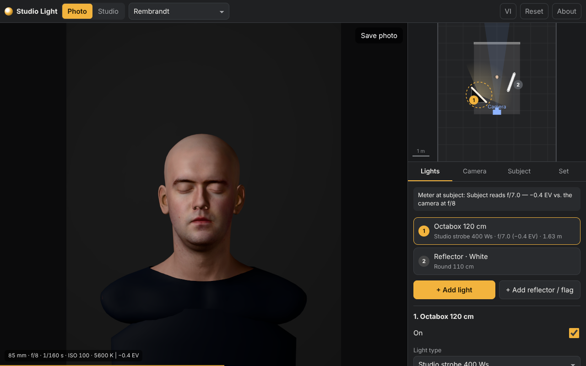

# Studio Light

Giả lập ánh sáng studio 3D để học cách đánh đèn chân dung và sản phẩm. Chạy trên iPhone, iPad và Mac bằng trình duyệt, cài được như một ứng dụng (PWA) và dùng được offline. Giao diện tiếng Việt và tiếng Anh.

A 3D studio lighting simulator for learning portrait and product lighting. Runs in the browser on iPhone, iPad and Mac, installs as a PWA and works offline. Vietnamese and English UI.



## Chạy thử / Run

Bản chạy sẵn: https://nhatduypanda-wq.github.io/studio-lighting-simulation/

Không cần build. Phục vụ thư mục này bằng bất kỳ web server tĩnh nào:

```sh
cd studio-lighting-simulation
python3 -m http.server 8080
# mở http://localhost:8080
```

Để dùng trên iPhone/iPad: đưa thư mục lên một host HTTPS (ví dụ GitHub Pages), mở bằng Safari, chọn **Chia sẻ → Thêm vào Màn hình chính**.

## Giai đoạn 1 có gì / What phase 1 includes

- **Chủ thể**: chân dung (đầu người quét 3D), bộ cầu tham chiếu (xám 18 %, chrome, trắng, sơn bóng), chai thủy tinh, bình gốm, bình lắc inox.
- **Đèn**: flash studio 400 Ws, speedlight, LED COB 300 W, LED panel 100 W (tối đa 5 đèn).
- **Phụ kiện**: chóa tiêu chuẩn, softbox 60×90, octabox 120, stripbox 30×120, dù xuyên, dù phản bạc, beauty dish, snoot, lưới tổ ong.
- **Hắt sáng / cờ**: tròn 80 và 110 cm, V-flat 1×2 m; trắng, bạc, vàng, đen.
- **Phông**: giấy seamless 8 màu và màu tùy chọn, khoảng cách chủ thể–phông, tường trắng/xám/đen.
- **Máy ảnh**: tiêu cự, khẩu độ (có độ sâu trường ảnh), tốc độ, ISO, cân bằng trắng, vị trí máy, khung hình, cảnh báo cháy sáng, lưu ảnh JPEG.
- **Học tập**: 8 bố cục mẫu, sơ đồ nhìn từ trên kéo thả được, đo sáng tại chủ thể cho từng đèn (f-stop và độ lệch EV), cảnh báo tốc độ đồng bộ flash.

## Mô hình ánh sáng / Lighting model

- Mỗi đèn là một nguồn sáng có bóng đổ, được lấy mẫu ngẫu nhiên trên đúng diện tích mặt phát sáng của phụ kiện và cộng dồn qua nhiều khung hình. Vì vậy độ mềm của bóng phụ thuộc vào kích thước và khoảng cách nguồn sáng như thật.
- Cường độ theo luật nghịch đảo bình phương; công suất tính bằng lumen-giây (flash) hoặc lumen (đèn liên tục) và quy đổi theo khẩu độ, ISO, tốc độ. Thẻ xám 18 % được đo đúng sáng sẽ ra giá trị 0,18.
- Hai đầu dò ánh sáng đặt tại chủ thể: một cái nhìn thấy mặt đèn (cho phản chiếu trên da, kim loại, thủy tinh), một cái không (cho ánh sáng dội từ tường, sàn, phông và tấm hắt sáng).
- Độ sâu trường ảnh và khử răng cưa cũng được cộng dồn bằng cách xê dịch máy ảnh trên khẩu độ thật (tiêu cự / 2N).

Giới hạn hiện tại: ánh sáng dội là xấp xỉ theo một điểm tại chủ thể, da chưa có tán xạ dưới da, mẫu người chưa có tóc và mắt nhắm. Dò tia (path tracing) nằm ở giai đoạn 2.

## Cấu trúc / Layout

| File | Vai trò |
|---|---|
| `index.html`, `styles.css` | Khung giao diện |
| `src/main.js` | Trạng thái, bảng điều khiển, lưu vào localStorage |
| `src/engine.js` | Dựng hình three.js, cộng dồn mẫu, đầu dò ánh sáng |
| `src/models.js` | Hình học phòng, phông, đèn, phụ kiện, chủ thể |
| `src/diagram.js` | Sơ đồ ánh sáng nhìn từ trên |
| `src/data.js` | Danh mục thiết bị, bố cục mẫu, công thức trắc quang |
| `src/i18n.js` | Chuỗi tiếng Việt và tiếng Anh |
| `sw.js`, `manifest.webmanifest` | PWA, chạy offline |

Khi sửa file, tăng `CACHE` trong `sw.js` để máy đã cài nhận bản mới.

## Ghi công / Credits

- Mẫu đầu người: “Infinite, 3D Head Scan” của Lee Perry-Smith, [CC BY 3.0](https://creativecommons.org/licenses/by/3.0/), xem `assets/LeePerrySmith_License.txt`.
- [three.js](https://threejs.org) (MIT), xem `vendor/THREE-LICENSE`.
